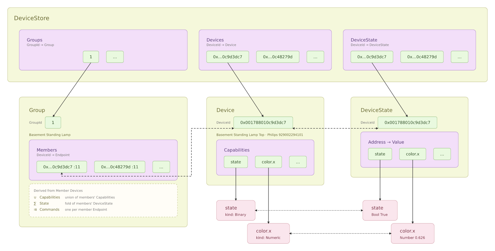

# Design

## The Main Loop (`Service.Daemon`)

The design of automation-service is based roughly on [Erlang's OTP model](https://www.erlang.org/doc/design_principles/des_princ) (and so has conceptual overlap with the [actor model](https://en.wikipedia.org/wiki/Actor_model) as well), but highly simplified: in the terminology of OTP, automation-service would provide a single predefined "supervisor" (`Server.Daemon`) which starts up "workers" (`Automation`), and the starting and stopping of workers happens via a message queue exclusively (...mostly). That is, there is no notion of a supervision tree, only a single supervisor node with a flat collection of workers under it.

Unlike with OTP's supervisors, the main loop in automation-service (a.k.a. `Service.Daemon`) cares little about the fate of automations other than starting them up and shutting them down; if they die immediately it shrugs and keeps going--although it does maintain state such that any running or scheduled automations are restarted/rescheduled on the next run if automation-service gets shut down. `Service.Daemon` is also in charge of scheduling automations at specific times, and loading device-related data into stored memory, functionality specific to home automation.

The main pieces, and their constraints and responsibilities, are as follows:
* The main control thread (`Service.Daemon`) listens on a queue for incoming actions to perform, and manages shared application state.
* Automation threads (`Service.Automations.*`) run specific automations either as one-off jobs or long-running threads. These should never directly modify shared application state, although they can read it. 
* `Service.Daemon` actions are triggered by Messages in a queue exclusively (`Service.MQTT.Messages.Daemon`)
* Automations can communicate with other automations and the outside world via publishing messages; all communication is mediated by `Service.Daemon`. (Also true for WebSocket access.)
* MQTT is the only protocol used by automation-service to communicate with the outside world, so far. I'd like to add Matter soon, perhaps via https://github.com/openthread/openthread ?

### How the Main Loop Manages Jobs

Main control is a single message queue that performs actions based on the messages it received. For example, the message (in JSON, sent over MQTT and parsed into a automation-service value):

```
{"start": "myAutomation"} -> Start (LuaScript "myAutomation")
```

...will trigger automation `Service.Automations.LuaScript` to run, which starts up a Lua script and either runs it in a loop, or runs it once and stops, as is determined by how the script was written (this particular behavior is unique to the `LuaScript` automation, vs. Main control, and will be described in more detail further down).

Main control also handles:

* loading running and scheduled automations from the last saved state (in SQLite db) on startup,
* ensuring automations that provide default but "auxiliary" functionality are loaded on start (currently that includes `StateManager`, which is what stores the state of automation-service, and `HTTP`, which serves the default web client), 
* scheduling automations, and ensuring scheduled automations are run,
* registering device and group information coming from the outside. Right now automation-service is heavily coupled to [Zigbee2MQTT](https://www.zigbee2mqtt.io/), but because it uses MQTT as its core communication protocol, this should enable greater interop in the future (in particular with [ESPHome](https://esphome.io/components/mqtt), and maybe Matter via https://github.com/kyberpunk/openthread-mqttsn or something?)


## Transport Adapters

(Note that this is discussing WIP as of 2026-10-04)

__ -- a.k.a. how automation-service communicates with Devices and Groups over Zigbee2MQTT (and eventually Matter) __

automation-service tries to provide an abstraction layer on top of how it communicates with devices and groups so the frontend and automations don't need to know about the MQTT protocol/Zigbee2MQTT, or eventually Matter. The goal is exactly to enable easier integration of Matter devices specifically, but more generally any other protocol, without needing to do anything but implement a conversion layer into standard types and messaging protocol.

For now the only adapter is the Zigbee2MQTT adapter. It parses device and group specification snapshots (https://www.zigbee2mqtt.io/guide/usage/exposes.html) into the corresponding generalized automation-service values, and handles communicating with zigbee2mqtt for state and other updates via the MQTT protocol so that automations, the frontend, and other parts of the system can respond and interact as expected.

With the Zigbee2MQTT adapter, a device specification is registered upon the response from subscribing to zigbee2mqtt/bridge/devices and correspondingly with zigbee2mqtt/bridge/groups. State updates are processed into standardized capability address/value delta pairs indexed by device ID, and state updates coming from the frontend or automations are sent to the adapter in the same format. The adapter translates those the address/value changes back as MQTT messages to the appropriate topic. 

All of these trigger corresponding TChan messages which are used to register functionality for communication with the rest of the system.

### Device and Group types

There are three core types for all Device transport interactions, `Device`, `Capability`, and `Group`. A `Group` collects `Devices` together so commands can be sent to them all simultaneously. A `Device` stores `Capabilities` indexed by the `Address`.

 

```haskell
data Device = Device
  { _name :: T.Text
  , _ieeeAddress :: T.Text
  , _manufacturer :: Maybe T.Text
  , _modelId :: Maybe T.Text
  , _capabilities :: Capabilities
  } deriving (Eq, Generic, Show)

newtype Endpoint = Endpoint Int

type GroupDevices = M.HashMap DeviceId Endpoint

type GroupId = Int

data Group = Group
  { _id :: GroupId
  , _name :: T.Text
  , _devices :: GroupDevices
  } deriving (Eq, Generic, Show)

type Capabilities = M.HashMap Address Capability

data Capability = Capability
  { _label :: T.Text
  , _description :: Maybe T.Text
  , _kind :: Kind
  , _access :: HashSet Access
  } deriving (Eq, Generic, Show)

type Address = T.Text

data Access
  = Reports
  | Writeable
  | Readable -- implies Reports as well for Zigbee2MQTT, but may not for Matter

data Kind
  = Binary
    { _valueOn :: T.Text
    , _valueOff :: T.Text
    , _valueToggle :: Maybe T.Text
    }
  -- Will these show up at all? Only via list item types, never as a
  -- top-level capability
  | Composite 
  | Enum
    { _values :: [ T.Text ] }
  | List
    { _itemType :: ItemType
    , _lengthMin :: Maybe Int
    , _lengthMax :: Maybe Int
    } 
  | Numeric
    { _unit :: Maybe T.Text
    , _valueMax :: Maybe Int
    , _valueMin :: Maybe Int
    , _valueStep :: Maybe Double
    , _presets :: [NumericPreset]
    }
  | Text
  deriving (Eq, Generic, Show)

```

`DeviceState` are `Values` in a `HashMap` indexed by the `Capability` address. All `Device` and `DeviceState` are indexed by `DeviceId`.

```haskell
type DeviceState = M.HashMap Address Value

data DeviceStore = DeviceStore
  { devices :: M.HashMap DeviceId Device
  , deviceState :: M.HashMap DeviceId DeviceState
  , groups :: M.HashMap GroupId Group
  } deriving (Eq, Generic, Show)
```

These types encode how `Device` state is read and mapped to functionality throughout the rest of the system, and how state is correspondingly updated, re-encoded back into the transport syntax and dispatched back out.


